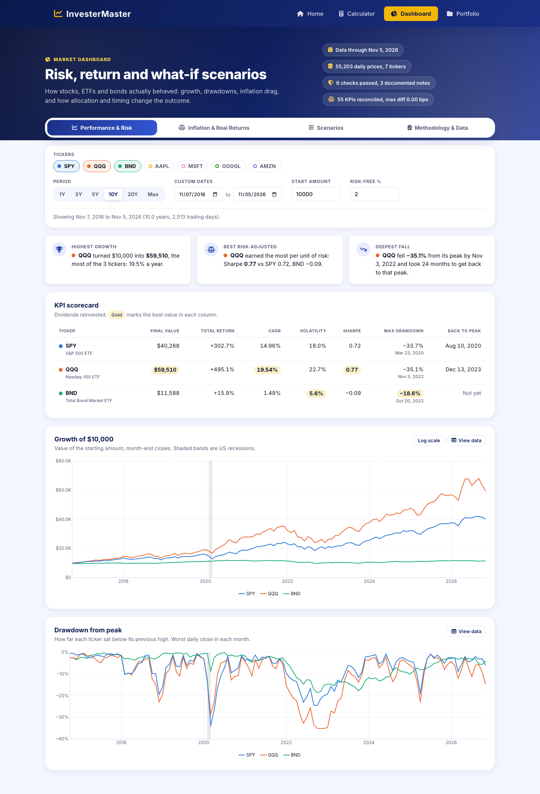
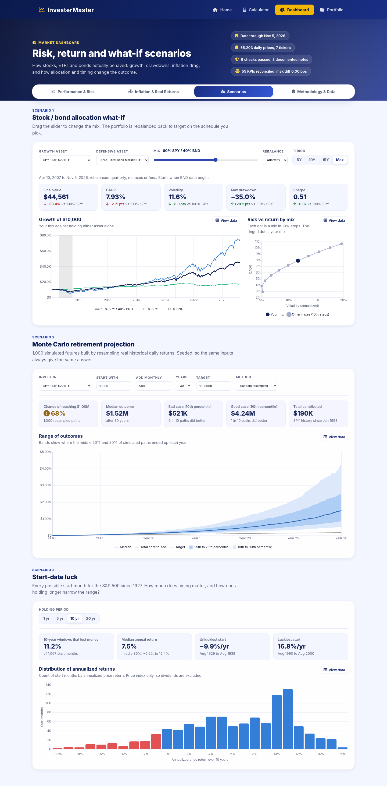

1. InvestorMaster

InvestorMaster is a stock market analysis and calculation tool that helps investors make informed decisions using historical data and real-time market trends. The project integrates NASDAQ, QQQ ETF, S&P 500 data with SQL database management, providing users with key insights into stock performance.

2. Features:

  - Stock Data Analysis: Retrieve and analyze historical stock prices.

  - Market Index Tracking: Support for NASDAQ, QQQ ETF, and S&P 500.

  - SQL Database Management: Store and query historical returns.

  - Frontend Interface: Built with HTML, CSS, and JavaScript.

  - Backend Processing: Developed using Python for efficient calculations.

  - Interactive Charts: Display stock trends visually.

  - Market Dashboard: Risk, return, inflation and scenario analysis across 7 tickers (see below).

Market Dashboard (dashboard.html)

A 4-tab analytics dashboard built on `data/stocks.db` (55,203 daily prices for SPY, QQQ, BND, AAPL, MSFT, GOOGL and AMZN, plus 956 months of CPI and S&P 500 index history back to 1927).

  - Performance & Risk: KPI scorecard (total return, CAGR, volatility, Sharpe ratio, max drawdown and recovery date), growth of $X and drawdown charts, with ticker, period, start-amount and risk-free filters.
  - Inflation & Real Returns: nominal vs real CAGR, purchasing-power growth, calendar-year real returns, CPI year over year, and rolling 12-month volatility.
  - Scenarios: a stock/bond allocation what-if with a risk-vs-return curve, a seeded 1,000-path Monte Carlo retirement projection, and a start-date luck histogram across every S&P 500 start month since 1927.
  - Methodology & Data: live data-quality checks, KPI definitions, ticker coverage, and KPI reconciliation results.

Every KPI is computed once in `server/dashboard_logic.py`, then served by `/api/dashboard/*` and exported for Power BI. `scripts/reconcile_kpis.py` checks 55 KPI values against the app's original `/api/calculate` and `/api/portfolio` engines. The largest difference is 0.00 bps at 2-decimal precision. The filters are saved in the URL, so any view can be shared as a link.

More screenshots: [Inflation & Real Returns](docs/screenshots/dashboard-inflation.png), [Methodology & Data](docs/screenshots/dashboard-methodology.png). The Power BI version of the same model is in [docs/powerbi_dashboard.md](docs/powerbi_dashboard.md).

3. Installation

    Prerequisites

  - Python 3.x

  - No Node.js or external database needed — data is stored in the bundled SQLite file (`data/stocks.db`).

4. Steps

    Clone the repository:

    - git clone https://github.com/yourusername/InvestorMaster.git
    - cd InvestorMaster

    Install backend dependencies:

    - pip install -r requirements.txt

    Configure environment variables:

    - cp server/.env.example server/.env
    - Fill in `NEWSAPI_KEY` in `server/.env` (get a free key at https://newsapi.org/register). This is optional — the news section just shows nothing if it's left blank.

    Start the backend server:

    - python server/app.py
    - This starts the Flask API on http://localhost:5001. It serves `/api/calculate` (backed by `data/stocks.db`, auto-populated from yfinance on first request for a symbol/date range) and `/api/news`.

    Launch the frontend:
    - Open index.html in a browser or serve it using a local development server (e.g. `python -m http.server`). The frontend calls the Flask API at `http://localhost:5001` (see `API_BASE_URL` in `js/shared.js`).

5. Project Structure

    - index.html, calculator.html — page shells; all markup is rendered by JS at load time
    - css/ — stylesheet (royal blue & white theme)
    - js/ — components.js (navbar/footer), shared.js (utilities, API calls), home.js, calculator.js (per-page rendering)
    - server/ — Flask backend (`app.py`, `calculator_logic.py`), DB setup scripts, `.env.example`
    - data/ — stocks.db and historical CSV datasets
    - dashboard.html, js/dashboard.js — Market Dashboard page
    - server/dashboard_logic.py — KPI, allocation, rolling-window and data-quality logic behind /api/dashboard/* and the export
    - server/analytics_views.sql — clean analysis views (daily/monthly returns, drawdown, CPI-adjusted real returns, index levels, ticker coverage)
    - scripts/export_powerbi.py — exports the views to powerbi_export/ for Power BI or Excel
    - scripts/reconcile_kpis.py — checks dashboard KPIs against the original calculation engines
    - powerbi_export/ — committed CSV snapshot used by the Power BI report
    - docs/ — Power BI build guide and dashboard screenshots

    Power BI / analytics export

    - python scripts/export_powerbi.py
    - Opens stocks.db read-only (views are created as TEMP views), so the export never modifies the database or calls yfinance.
    - Monte Carlo projections reuse RetirementProjector with a fixed seed (42), so the snapshot is reproducible.
    - powerbi_export/kpi_definitions.csv documents every KPI formula; data_quality.csv and data_quality_before_fix.csv show the data-quality checks after and before cleanup.
    - python scripts/reconcile_kpis.py rewrites powerbi_export/reconciliation.csv and exits with an error if any KPI drifts more than 1 bp from the original engines.
    - /api/news now stores each headline it serves in a news_headlines table (deduplicated by URL) so the headlines can be analyzed later.
    - To make the views permanent (e.g. for ODBC): sqlite3 data/stocks.db < server/analytics_views.sql

6. Usage

  - Enter a stock symbol to retrieve historical data.
  
  - View interactive charts displaying trends and analytics.
  
  - Compare stock performance across indices.
  
  - Store and query data from the database.

7. Contributing

  Pull requests are welcome! For major changes, please open an issue first to discuss the proposed update.
